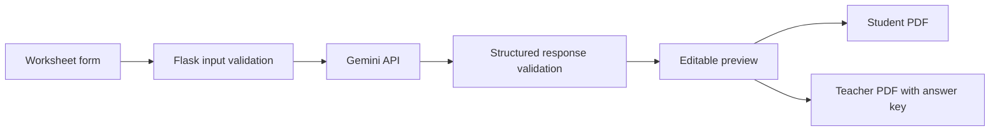

# Lessonleaf AI Worksheet Generator

A beginner-friendly Flask application for drafting, editing, and printing classroom worksheets with Google's Gemini API.

## First-version features

- Worksheet requests for subject, grade, topic, difficulty, question count, question types, language, and instructions.
- Structured AI output validated on the server. Missing credentials and provider errors are reported; there are no fake sample questions.
- SQLite-backed worksheet library with search by title, subject, class, and topic; worksheets remain available after restarting the app.
- Open saved worksheets, edit worksheet text and answers, add or remove questions, and save changes to SQLite.
- Original generation settings, AI prompt, and system instruction are stored with each generated worksheet. Use **Create similar** to reload those settings into the form.
- Separate student and teacher PDF downloads.
- Hindi and Marathi PDF text shaping when a Devanagari TrueType font is available.
- No accounts or cloud sync; this local version stores worksheets on the computer running the app.

## Requirements

- Windows 10 or 11
- Python 3.12
- Internet access for Gemini generation
- A Gemini API key from [Google AI Studio](https://aistudio.google.com/app/apikey)

Gemini access may be subject to quotas, changing model availability, and provider pricing. Check the current terms and usage limits for your account. The application does not guarantee that AI-generated questions or answers are correct; review them before classroom use.

## Run on Windows PowerShell

Open PowerShell in this project folder, then run:

```powershell
py -3.12 -m venv .venv
.\.venv\Scripts\python.exe -m pip install --upgrade pip
.\.venv\Scripts\python.exe -m pip install -r requirements.txt
Copy-Item .env.example .env
notepad .env
```

In `.env`, paste your key after `GEMINI_API_KEY=` and save the file. Do not share the key, commit `.env`, or put it in JavaScript. If the `py -3.12` command is unavailable, install Python 3.12 from [python.org](https://www.python.org/downloads/windows/) and enable the Python launcher during setup.

Start the app:

```powershell
.\.venv\Scripts\python.exe app.py
```

Open [http://127.0.0.1:5000](http://127.0.0.1:5000). To stop the local server, press `Ctrl+C` in PowerShell.

If PowerShell says the API is not configured, check that `.env` is in the project root and that `GEMINI_API_KEY` has a value. A rate-limit message means Gemini has asked the app to wait; retry later. The app does not log the key.

## Worksheet storage

The app creates `instance\worksheets.sqlite3` the first time its worksheet library loads. Set `WORKSHEET_DB_PATH` in `.env` to use a different local SQLite file. The database contains worksheet content, editable answers, generation settings, and the prompts sent to Gemini. Keep the database private because it may contain teacher-created or student-related material.

## Hindi and Marathi PDF font

The PDF export uses `fpdf2` with HarfBuzz text shaping. It automatically checks common Windows Devanagari fonts, including Nirmala and Mangal. If your font is elsewhere, set `WORKSHEET_UNICODE_FONT` in `.env` to the full path of a Devanagari `.ttf` font. Hindi and Marathi PDF export returns a clear error if no usable font is found instead of silently substituting unreadable glyphs.

## Run tests

```powershell
.\.venv\Scripts\python.exe -m unittest discover -s tests -v
```

Tests cover request validation, malformed and duplicate AI output, missing API-key behavior, worksheet persistence/search/editing, the PDF route, and PDF creation. The live Gemini service is not called by the test suite. To check real generation, configure your own key and submit a worksheet in the app.

## Project layout

```text
app.py                      Flask pages and API routes
worksheet_generator.py      Input validation, Gemini call, and response validation
worksheet_store.py          SQLite schema and worksheet persistence/search
pdf_export.py               Printable PDF generation and Unicode font selection
templates/index.html        Accessible worksheet builder and preview
static/styles.css           Responsive visual design
static/app.js               Form submission, editable preview, and downloads
tests/                      Offline backend and PDF tests
.env.example                Local configuration template
requirements.txt            Python dependency ranges
```

## Request flow



## Current boundaries and next stages

The app is intended for local use and does not provide user accounts, access controls, cloud sync, analytics, or production hosting configuration. The worksheet library is stored on the local machine and is not encrypted. Before public deployment, add authentication and ownership checks, CSRF protection, rate limiting, production server configuration, stricter operational monitoring, and an explicit privacy policy. Do not deploy Flask's development server.

Possible next enhancements include worksheet history, teacher accounts, answer-key review workflows, exports to DOCX, curriculum-aligned templates, and deployment after a security review.